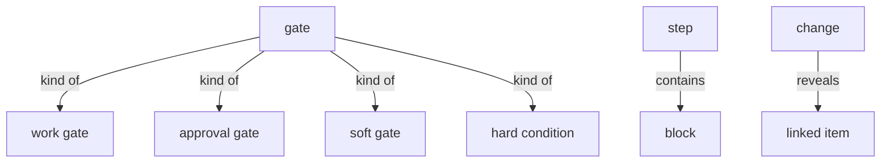
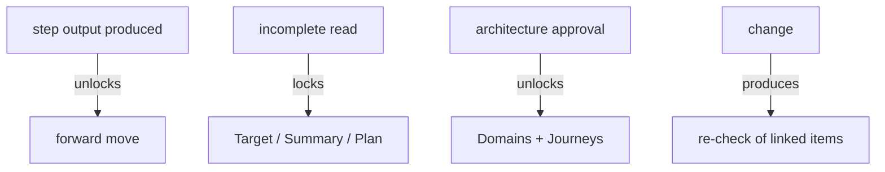

# Section draft - governance-gating

> Source: `mcp-spec-v4.md` section 5 (Gating), section 6 (Update linked items); `mcp-requirements-v4.md` section 11 (Case-driven output), section 12 (Governance). Repeats marked `KNOWN`.

## Ontology - the things

### Objects
| # | Term | Meaning | Evidence | Re-scan |
|---|---|---|---|---|
| 1 | gate | a readiness condition on moving forward | "The platform **gates** lightly" | NEW collides with method "gate" (decision checkpoint) |
| 2 | work gate | forward opens once a step produced its output | "This is a **work gate**, not an approval gate" | NEW |
| 3 | approval gate | a gate requiring someone to sign | "not an approval gate" | NEW |
| 4 | hard condition | a non-soft lock (incomplete read; architecture approval) | "Two hard conditions and one approval" | NEW |
| 5 | approval | the one MVP approval - target architecture | "**Approval** - the Target architecture" | KNOWN = architecture approval |
| 6 | sign-off | an approve/sign control - absent on the deliverable | "There is **no sign-off** control" | NEW vs approval / agree |
| 7 | RBAC | role-based access control - absent in the MVP | "There is no **RBAC** in the MVP" | NEW = access control |
| 8 | linked item | a platform object a change re-checks | "updates ... its **linked objects**"; "**Update linked items**" | NEW = linked object |
| 9 | re-check | the transient impact check after a change | "shows a transient **re-check**" | NEW = impact propagation / ripple |
| 10 | impact propagation | in-platform spread of a change to linked items | "the **in-platform** form of impact propagation" | NEW |
| 11 | block | a case-driven unit a step produces | "its **blocks** ... the sections ... domains ... views ... waves ... stories" | NEW = section / unit |
| 12 | case | the specific system + what the read/team found | "**'the case'** means the specific system being modernized" | NEW vs system / source system |

### Roles
| # | Term | Meaning | Evidence | Re-scan |
|---|---|---|---|---|
| - | None. | governance describes behaviour, not actors | - | - |

### Steps
| # | Term | Meaning | Evidence | Re-scan |
|---|---|---|---|---|
| 1 | update linked items | re-check a change's impact across linked objects | "re-checks its impact across the platform's own linked objects" | NEW = re-check |
| 2 | regeneration | rebuild an artifact from resolved notes | "**Regeneration is the in-artifact form of this update**" | KNOWN |
| 3 | one-way export | send a settled artifact out; nothing pulled back | "exported for use in the team's own tools ... nothing is pulled back" | KNOWN |

### States & values
| # | Term | Values | Evidence | Re-scan |
|---|---|---|---|---|
| 1 | gate type | work gate, approval gate, soft gate, hard condition | "a **work gate**, not an approval gate"; "otherwise **soft-gated**"; "Two hard conditions" | NEW |
| 2 | lock state | locked, unlocked | "keeps ... locked until it is resumed or re-run" | NEW |
| 3 | direction of travel | forward (gated), backward (free) | "**Forward is gated** ... **Backward is free**" | NEW |
| 4 | scope band | in scope, deferred | "**in** = Goal -> ... -> Plan ... **Deferred** = Delivery / Run ..." | KNOWN |

## Topology - the tree

**Verbatim**

| Parent (A) | relationship | Child (B) | Evidence |
|---|---|---|---|
| gate | kind of | - work gate - approval gate - soft gate - hard condition | "a work gate, not an approval gate"; "soft-gated"; "Two hard conditions" |
| step | contains | block (case-driven) | "its **blocks**" |
| block | kind of | - goal section - domain / architecture view / gap - summary section - wave / epic / story | "the sections ... the domains, architecture views, and gaps ... the waves, epics, and stories" |
| change | reveals | linked item (re-check) | "re-checks its impact across ... linked objects" |

**Mermaid**

## Choreography - states & gates

**States**

| Thing | States | Evidence |
|---|---|---|
| step | - locked - unlocked (gate met) | "The move to the next step opens only once the current step has produced its output" |
| block | - shown (has real content) - absent (nothing to say) | "A block appears only when it has real content" |

**Gates (verbatim)**

| A | relationship | B | Evidence |
|---|---|---|---|
| step output produced | unlocks | forward move | "Forward opens once a step has produced its own output" |
| incomplete read | locks | Target, Summary, Plan | "an incomplete or stopped read ... locks Target, Summary, and Plan" |
| architecture approval | unlocks | Domains + Journeys | "the target architecture must be approved ... unlocks Domains and Journeys" |
| change | produces | re-check of linked items | "re-checks its impact ... updates what it affects" |
| resolved change | produces | ripple across linked objects | "the same resolved change also ripples across the linked objects" |

**Mermaid**

## Conflict flags (for Gate 1)
- **gate collides:** product `gate` / `gating` (a readiness lock) vs the method's own `gate` (a person's decision checkpoint).
- **propagation cluster:** `update linked items` / `re-check` / `impact propagation` / `ripple` / `regeneration` - one behaviour, many words.
- `linked item` vs `linked object` - one word.
- `block` vs `section` vs `summary section` vs `goal section` - is a "section" a kind of "block"?
- **sanction cluster:** `sign-off` / `approval` / `agree` / `agreement` - several words for "the team commits."
- `access control` vs `RBAC` - one thing, two words.
- `case` vs `system` vs `source system` - "the case" is the specific system.
