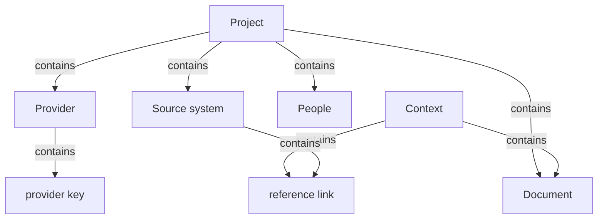
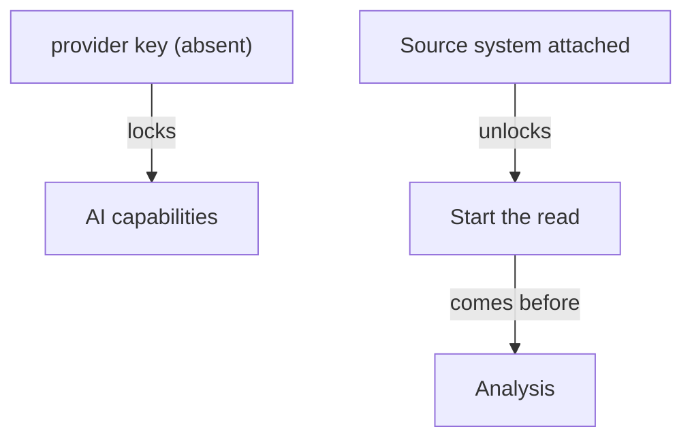

# Section draft - inputs

> Source: `mcp-spec-v4.md` section 2.2; `mcp-requirements-v4.md` section 1 (Onboarding), section 3 (Setup). Repeats marked `KNOWN`.

## Ontology - the things

### Objects
| # | Term | Meaning | Evidence | Re-scan |
|---|---|---|---|---|
| 1 | Project | one modernization effort, the container for all else | "The modernization effort itself - the single place all of the below live" | NEW |
| 2 | Provider | the one AI provider + key that powers the read | "The AI provider and its key that power the read" | NEW |
| 3 | provider key | the credential for the provider; optional at creation | "its key is optional at creation" | NEW = "the key" / "API key" |
| 4 | Source system | the legacy codebase, connected read-only | "The legacy codebase under modernization, connected read-only" | NEW = repository / Repo / source |
| 5 | repository | an attached source, with name, location, account | "attached as one or more repositories" | NEW cluster |
| 6 | Repo | a single source opened to inspect/correct | "**Repo** (Detail) inspects and corrects a single source" | NEW cluster |
| 7 | Document | written material describing the system | "The written material that describes the system - briefs, specs, policies, runbooks" | NEW = Context / reference material |
| 8 | Context | engagement-wide reference material | "Reference material that applies to the whole engagement is placed in Context" | NEW cluster |
| 9 | reference link | a linked source (e.g. Confluence, Figma) | "reference links such as Confluence or Figma" | NEW |
| 10 | account | the credential a repository is reached through | "the account it is reached through" | NEW |
| 11 | engagement | the whole effort a document may apply to | "applies to the whole engagement" | NEW overlaps Project |
| 12 | API | the provider tab / configuration | "**API** (the one provider - rotate the key...)" | NEW overloaded (config vs interface) |

### Roles
| # | Term | Meaning | Evidence | Re-scan |
|---|---|---|---|---|
| 1 | People | the team who govern the work, each with a persona | "The team who will govern the work, each carrying a persona" | NEW = team / member / person |
| 2 | team member | a named person with email and role(s) | "named with an email and given one or more roles" | NEW cluster |

### Steps
| # | Term | Meaning | Evidence | Re-scan |
|---|---|---|---|---|
| 1 | Onboarding | identify the person, set up the project | "Onboarding is where a person is identified and an effort is set up" | KNOWN |
| 2 | Setup | bring the system in on an attributed footing | "Setup brings the legacy system into the effort" | KNOWN |

### States & values
| # | Term | Values | Evidence | Re-scan |
|---|---|---|---|---|
| 1 | health status | reachable, unreachable, auth needed, not tested | "each carries a health status (reachable, unreachable, auth needed, not tested)" | NEW |
| 2 | document scope | whole system, one part | "marked as describing the **whole system** or **one part**" | NEW |
| 3 | member status | active, inactive | "each active or inactive" | NEW |
| 4 | provider presence | has provider, no provider (no key) | "a project without a key is marked as having no provider" | NEW |
| 5 | name lock | locks after creation | "a name that **locks after creation**" | NEW |

**Dropped (why):** "New-project modal", "Save / Discard / Back bar", "tabs" (UI mechanism); "briefs, specs, policies, runbooks" (examples of Document, not terms).

## Topology - the tree

**Verbatim**

| Parent (A) | relationship | Child (B) | Evidence |
|---|---|---|---|
| Project | contains | - Provider - Source system - Document - People | "the single place all of the below live" |
| Project | contains | provider (one-to-one) | "A project carries exactly **one provider**" |
| Provider | contains | provider key | "The AI provider and its key" |
| Source system | contains | reference link (scoped) | "documents and reference links ... attached to that one source" |
| Context | contains | - Document - reference link | "grouped by type (documents, and reference links...)" |
| team member | kind of | People | "The team who will govern the work" |

**Mermaid**

## Choreography - states & gates

**States**

| Thing | States | Evidence |
|---|---|---|
| repository | - reachable - unreachable - auth needed - not tested - disconnected | "a disconnected source remains listed and is excluded from Analysis" |
| Project | - has provider - no provider | "marked as having no provider" |
| team member | - active - inactive | "each active or inactive" |

**Gates (verbatim)**

| A | relationship | B | Evidence |
|---|---|---|---|
| provider key (absent) | locks | AI capabilities | "Without the key the project's AI capabilities ... are unavailable" |
| Source system (>=1 attached) | unlocks | Start the read | "available once at least one repository is attached" |
| Start the read | comes before | Analysis | "It moves the effort to Analysis" |
| repository (disconnected) | locks | its inclusion in Analysis | "excluded from Analysis until reconnected" |

**Mermaid**

## Conflict flags (for Gate 1)
- **Source cluster:** `Source system` (spec) / `source` / `repository` / `Repo` (req + surfaces) - one thing, up to four words.
- **Document cluster:** `Document` / `Context` / `reference material` / `reference link` - split the whole-system doc, the engagement doc, and the linked doc, or unify?
- **Provider cluster:** `Provider` / `AI provider` / `provider key` / `the key` / `API` - one config, several labels.
- **People cluster:** `People` / `team` / `team member` / `person` / `reviewer` (later) - one word for the actor.
- `engagement` vs `Project` - same effort, two words?
