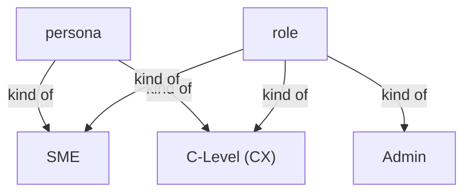
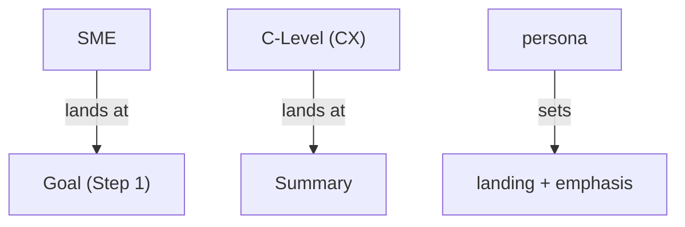

# Section draft - personas

> Source: `mcp-spec-v4.md` section 3; `mcp-requirements-v4.md` Personas, section 12.1. Repeats marked `KNOWN`.

## Ontology - the things

### Objects
| # | Term | Meaning | Evidence | Re-scan |
|---|---|---|---|---|
| 1 | persona | a lens on the same artifacts (not a separate app) | "**lenses on the same artifacts, not separate applications**" | NEW overlaps "role" |
| 2 | access control | permission enforcement - absent in the MVP | "there is **no access control**: everyone can see everything" | NEW |
| 3 | landing | where a persona lands by default | "the persona only changes landing and emphasis" | NEW |
| 4 | emphasis | what a persona weights/emphasises | "weights where they land and what they emphasise" | NEW |
| 5 | entry point | an intent-based start (not enforcement) | "Entry points are intent, not enforcement" | NEW |

### Roles
| # | Term | Meaning | Evidence | Re-scan |
|---|---|---|---|---|
| 1 | SME | the practitioner who does the work | "SME - the practitioner" | NEW = practitioner |
| 2 | practitioner | the SME's descriptor | "the practitioner ... who do the actual modernization work" | NEW cluster |
| 3 | C-Level (CX) | the overseer - delivery/client leadership | "C-Level (CX) - the overseer" | NEW = overseer / CX |
| 4 | overseer | the C-Level's descriptor | "C-Level (CX) - the overseer" | NEW cluster |
| 5 | Admin | a setup/access role, not a persona | "**Admin** is a setup and access role, not a persona" | NEW |
| 6 | delivery team | who executes the handed-off plan | "the delivery team can pick up" | NEW |
| 7 | person | the general actor, attributable | KNOWN | KNOWN actor cluster |

### Steps
| # | Term | Meaning | Evidence | Re-scan |
|---|---|---|---|---|
| - | None. | personas describe actors, not steps | - | - |

### States & values
| # | Term | Values | Evidence | Re-scan |
|---|---|---|---|---|
| 1 | role | SME, C-Level, Admin | "roles (SME, C-Level, Admin...)" | NEW collides with "persona" |
| 2 | access model | no access control (everyone sees everything) | "no access control - everyone sees everything" | NEW |

## Topology - the tree

**Verbatim**

| Parent (A) | relationship | Child (B) | Evidence |
|---|---|---|---|
| persona | kind of | - SME - C-Level (CX) | "serves **two personas**" |
| role | kind of | - SME - C-Level - Admin | "roles (SME, C-Level, Admin...)" |
| SME | kind of | - specifier - builder - designer - architect | "specifiers, builders, designers, architects" |

**Mermaid**

## Choreography - states & gates

**States**

| Thing | States | Evidence |
|---|---|---|
| team member | - holds SME - holds C-Level - holds Admin | "Admin being ... held alongside SME or C-Level" |

**Gates (verbatim)**

| A | relationship | B | Evidence |
|---|---|---|---|
| persona | comes before | landing + emphasis | "a persona weights where they land and what they emphasise" |
| SME | comes before | Goal (Step 1) | "SMEs start at Step 1 (Goal)" |
| C-Level | comes before | Summary | "C-Level (CX) people come in at the Summary" |

**Mermaid**

## Conflict flags (for Gate 1)
- **persona vs role:** SME and C-Level are both `persona` and `role`; `Admin` is a `role` but not a `persona`. Overlapping words.
- `SME` / `practitioner`; `C-Level` / `CX` / `overseer` - one actor, several labels.
- actor cluster continues: `person` / `user` / `reviewer` / `team member` / `People`.
