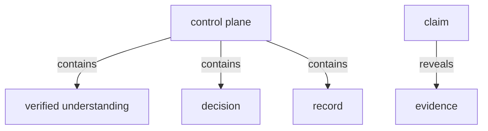
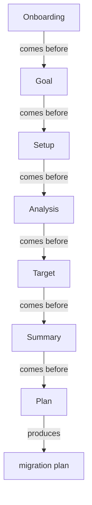

# Section draft - product-model

> Source: `mcp-spec-v4.md` section 1 (Product model), section 7 (Scope). New build -> first-appearance rows `NEW`.

## Ontology - the things

### Objects
| # | Term | Meaning (<=12 words) | Evidence (exact quote - where) | Re-scan |
|---|---|---|---|---|
| 1 | control plane | the thin platform above the modernization work | "The platform is a **thin control plane** that sits *above* the modernization work" | NEW |
| 2 | verified understanding | the checked model of the system | "the **verified understanding** of the system" | NEW |
| 3 | decision | a choice the team records about the system | "the **decisions** the team makes about it" | NEW |
| 4 | record | the kept trace of understanding and decisions | "the **record** of both" | NEW |
| 5 | claim | an assertion that must trace to its source | "Every claim traces to its source" | NEW |
| 6 | source | what a claim traces back to | "every claim traces to its source" | NEW collides with "Source system" (inputs) |
| 7 | evidence | the same basis the team reasons on | "on the same evidence" | NEW |
| 8 | artifact | the shared thing people reason and decide on | "reason on the *same artifact*" | NEW |
| 9 | migration plan | the terminal deliverable handed off | "handing off the migration plan" | NEW = "the plan" (decisions-and-plan) |
| 10 | headline number | a roll-up figure that rebuilds from rows | "every headline number rebuilds from the rows beneath it" | NEW |

### Roles
| # | Term | Meaning | Evidence | Re-scan |
|---|---|---|---|---|
| 1 | team | the people who govern and decide | "People **govern and decide, together**" | NEW |
| 2 | AI | the engine that does the cognition | "The AI does the cognition" | NEW |

### Steps
| # | Term | Meaning | Evidence | Re-scan |
|---|---|---|---|---|
| 1 | Onboarding | access + project, before the thread | "preceded by Onboarding" | NEW |
| 2 | Goal | record why, before the read | "Goal -> Setup -> Analysis -> Target -> Summary -> Plan" | NEW |
| 3 | Setup | bring the system in | (forward thread) | NEW |
| 4 | Analysis | understand the as-is | (forward thread) | NEW |
| 5 | Target | set the to-be | (forward thread) | NEW |
| 6 | Summary | assemble the deliverable | (forward thread) | NEW |
| 7 | Plan | sequence the move | (forward thread) | NEW |
| 8 | export (one-way) | send an artifact out, nothing pulled back | "artifacts are **exported one-way**" | NEW |

### States & values
| # | Term | Values | Evidence | Re-scan |
|---|---|---|---|---|
| 1 | verification stance | verified, asserted | "**Verified, not asserted**" | NEW |
| 2 | held as unknown | (a claim's honest not-known state) | "shown as **held as unknown**, never assumed" | NEW |
| 3 | scope band | in scope, deferred | "the full in-scope / deferred split" | NEW |

## Topology - the tree

**Verbatim**

| Parent (A) | relationship | Child (B) | Evidence |
|---|---|---|---|
| control plane | contains | - verified understanding - decision - record | "owns exactly three things: the verified understanding ..., the decisions ..., and the record of both" |
| claim | reveals | evidence | "Every claim traces to its source" (evidence beneath a claim) |

**Mermaid**

## Choreography - states & gates

**States**

| Thing | States | Evidence |
|---|---|---|
| claim | - verified - held as unknown | "What cannot be verified is shown as **held as unknown**" |

**Gates (verbatim)**

| A | relationship | B | Evidence |
|---|---|---|---|
| Onboarding | comes before | Goal | "Six steps ... preceded by Onboarding" |
| Goal | comes before | Setup | "Goal -> Setup" |
| Setup | comes before | Analysis | "Setup -> Analysis" |
| Analysis | comes before | Target | "Analysis -> Target" |
| Target | comes before | Summary | "Target -> Summary" |
| Summary | comes before | Plan | "Summary -> Plan" |
| Plan | produces | migration plan | "stops at handing off the migration plan" |

**Mermaid**

## Conflict flags (for Gate 1)
- `source` (a claim's origin) collides with `Source system` (the codebase) in inputs - one word, two meanings.
- `migration plan` here vs `the plan` / `Plan` (the step) - align.
- `evidence` (this doc) vs `Evidence` (the cross-cutting layer/object) - one word, two scopes.
