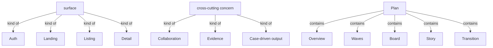
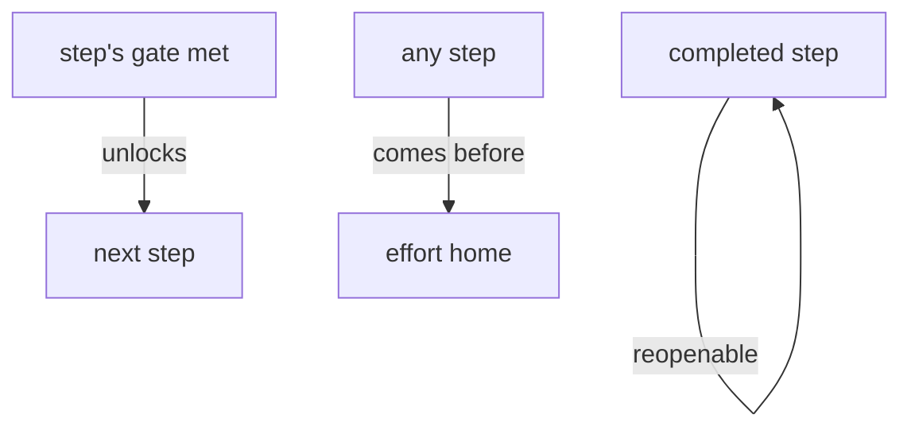

# Section draft - surfaces-and-navigation

> Source: `mcp-spec-v4.md` section 4 (Surfaces); `mcp-requirements-v4.md` section 8 (Navigation). Repeats marked `KNOWN`.

## Ontology - the things

### Objects
| # | Term | Meaning | Evidence | Re-scan |
|---|---|---|---|---|
| 1 | surface | a view onto the objects | "The surfaces are views onto the objects" | NEW vs step / screen |
| 2 | cross-cutting concern | a surface that rides on the surfaces it applies to | "**cross-cutting concerns** that ride on the surfaces they apply to" | NEW |
| 3 | thread | the forward walk through the steps | "before the thread"; "the **forward thread**" | NEW = walk / forward thread |
| 4 | hub | a landing with spokes returning to it | "the Overview is the hub; the rest return to it" | NEW |
| 5 | station | a step on the path (vs an on-demand drawer) | "not a **station** on the path and not a persistent rail" | NEW |
| 6 | Login | the auth surface establishing the actor | "**Login** (Auth) - establish the acting person" | NEW |
| 7 | Projects | the listing where efforts live | "**Projects** (Listing) - start or resume a modernization effort" | NEW |
| 8 | Board | a wave broken into executable work | "**Board** (Detail) - break a wave into executable work" | NEW |
| 9 | Story (surface) | one unit of work specified to hand off | "**Story** (Detail) - specify one unit of work fully enough to hand off" | KNOWN (= story) |
| 10 | Transition | the reference-only cutover surface | "**Transition** (Detail, reference-only) - the safe cutover" | NEW = transition approach |

### Roles
| # | Term | Meaning | Evidence | Re-scan |
|---|---|---|---|---|
| - | None. | - | - | - |

### Steps
| # | Term | Meaning | Evidence | Re-scan |
|---|---|---|---|---|
| 1 | Onboarding, Goal, Setup, Analysis, Target, Summary, Plan | the seven steps (surfaces) | "the walk runs **Onboarding**, then **Goal -> ... -> Plan**" | KNOWN |
| 2 | navigate | move among the steps, know where you are | "move through an effort and always know where they are" | NEW |

### States & values
| # | Term | Values | Evidence | Re-scan |
|---|---|---|---|---|
| 1 | surface type | Auth, Landing, Listing, Detail | "Surface types are Auth, Landing, Listing, Detail" | NEW |
| 2 | run state | lowercase flow states on a surface (running, paused, compiling...) | "lowercase words are run states" | NEW = read run state |

**Dropped (why):** the many named sub-surfaces treated as instances of `surface` (Team, Repositories, Context, Domains, Architecture, Journeys, Overview, Waves, Project & API) - captured where their object/step is owned; "rail / pane / drawer / cockpit" (UI mechanism).

## Topology - the tree

**Verbatim**

| Parent (A) | relationship | Child (B) | Evidence |
|---|---|---|---|
| surface | kind of | - Auth - Landing - Listing - Detail | "Surface types are Auth, Landing, Listing, Detail" |
| thread | contains | the seven steps | "the walk runs Onboarding, then Goal -> ... -> Plan" |
| cross-cutting concern | kind of | - Collaboration - Evidence - Case-driven output | "Three of them - Collaboration, Evidence, and Case-driven output" |
| Analysis | contains | - Quick analysis - Deep analysis | "understand the as-is in two passes" |
| Deep analysis | reveals | - Domains - Architecture | "It drills two ways" |
| Plan | contains | - Overview - Waves - Board - Story - Transition | "the Overview is the hub; the rest return to it" |

**Mermaid**

## Choreography - states & gates

**States**

| Thing | States | Evidence |
|---|---|---|
| surface | - Locked (before it opens) - live | "Locked (full chrome, controls disabled, before it opens)" |

**Gates (verbatim)**

| A | relationship | B | Evidence |
|---|---|---|---|
| step's gate met | unlocks | move to next step | "When a step's gate is met, moving on to the next step is available" |
| completed step | comes before | reopen (free) | "a completed step can be reopened at any time" |
| any step | comes before | return home | "a person can return to the effort's home" |

**Mermaid**

## Conflict flags (for Gate 1)
- `surface` vs `step` vs `screen` vs `page` - a surface is a view onto objects, a step is a thread stage; several sub-surfaces per step. Clarify surface vs step.
- `thread` / `walk` / `forward thread` - one path, several words.
- `Story` (Plan surface) vs `story` (work unit) vs `user story`; `Transition` (surface) vs `transition approach` (object).
- `run state` (surface) vs `run state` (the read) - same words, confirm one meaning.
- `station` vs `step` vs `surface` - used to contrast Evidence ("not a station on the path").
