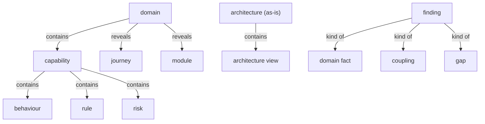
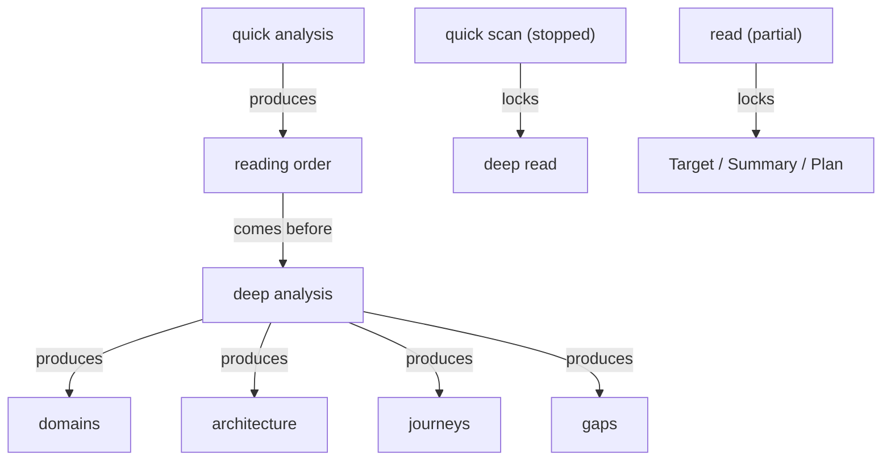

# Section draft - understanding

> Source: `mcp-spec-v4.md` section 2.3; `mcp-requirements-v4.md` section 4 (Analysis). Repeats marked `KNOWN`.

## Ontology - the things

### Objects
| # | Term | Meaning | Evidence | Re-scan |
|---|---|---|---|---|
| 1 | read state | the read as an object - progress + remainder + run state | "The read itself is an object ... It carries **progress** ... a **held remainder** ... and a **run state**" | NEW = "the read" |
| 2 | progress | how much is understood against the total | "**progress** (how much is understood against the total)" | NEW |
| 3 | held remainder | what could not be read, held as unknown | "a **held remainder** (what could not be read...)" | NEW |
| 4 | reading order | a defensible, dependency-aware order to read in | "a defensible order to read the system in" | NEW |
| 5 | dependency graph | the mapped dependencies between sources | "produces a dependency graph and a recommended reading order" | NEW |
| 6 | domain | the as-is organised by business domain | "The as-is system organised by **business domain**" | NEW = business domain; vs target domain |
| 7 | capability | what a domain groups | "Each domain groups its **capabilities**" | NEW |
| 8 | behaviour | a capability's traced action | "each capability carries its **behaviours** (each traced to a place in the source)" | NEW |
| 9 | rule | a capability's rule, marked sound/defect/gap | "its **rules** (marked sound, defect, or gap)" | NEW collides with method "rule" & "business rule" |
| 10 | risk | a capability's risk | "and its **risks**" | NEW |
| 11 | module | part of a domain, carrying dependencies/coupling | "each domain opens to its journeys and its **modules**" | NEW collides with method "section/module" |
| 12 | coupling | how tightly modules/domains connect | "modules carry their dependencies and coupling" | NEW |
| 13 | architecture (as-is) | the current architecture read fact by fact | "The current architecture read fact by fact" | NEW vs target architecture |
| 14 | architecture view | a view of the architecture (functional, context...) | "**functional** capabilities, **context**, and **deployment** views" | NEW |
| 15 | journey | an end-to-end path people complete today | "The end-to-end paths people complete through the system today" | NEW vs target/current journey |
| 16 | gap | a ranked, categorised as-is shortfall | "The result presents the as-is gaps, ranked by severity and tagged by category" | NEW |
| 17 | finding | a cited item - a domain fact, coupling, or gap | "Every finding - a domain fact, a coupling, a gap" | NEW |
| 18 | evidence | the cited source a finding rests on | "opened to the evidence that supports it, cited to a place in the source" | KNOWN |

### Roles
| # | Term | Meaning | Evidence | Re-scan |
|---|---|---|---|---|
| - | None. | roles are named in personas | - | - |

### Steps
| # | Term | Meaning | Evidence | Re-scan |
|---|---|---|---|---|
| 1 | Analysis | understand the as-is in two passes | "understand the as-is in **two passes**" | KNOWN |
| 2 | quick analysis | first-pass scan -> reading order | "**Quick analysis** ... a steerable scan ... ends in a defensible **reading order**" | NEW = "quick scan" |
| 3 | deep analysis | reads a source in depth -> verified understanding | "**Deep analysis** ... reads a repository in depth" | NEW = "deep read" |
| 4 | the read | the AI reading the source (analysis) | "the read turns it into understanding" | NEW = read state; part/whole vs deep read |
| 5 | re-run | resume/restart a stopped read | "until it is resumed or re-run" | NEW |

### States & values
| # | Term | Values | Evidence | Re-scan |
|---|---|---|---|---|
| 1 | run state | running, paused, stopped, complete (+ resumed, restarted, incomplete) | "a **run state** - running, paused, stopped, or complete"; "paused, resumed, stopped, and restarted" | NEW drift spec vs req |
| 2 | baseline authority | partial / non-authoritative, authoritative | "yields a **partial, non-authoritative** baseline" | NEW |
| 3 | fact status | settled, held as unknown | "Every fact is either **settled** or **held as unknown**" | NEW vs "open question" (Evidence) |
| 4 | rule quality | sound, defect, gap | "marked sound, defect, or gap" | NEW |
| 5 | gap severity | ranked by severity | "ranked by severity" | NEW |
| 6 | gap category | tagged by category | "tagged by category" | NEW |

## Topology - the tree

**Verbatim**

| Parent (A) | relationship | Child (B) | Evidence |
|---|---|---|---|
| domain | contains | capability | "Each domain groups its **capabilities**" |
| domain | reveals | - journeys - modules | "each domain opens to its journeys and its modules" |
| capability | contains | - behaviour - rule - risk | "each capability carries its **behaviours** ... its **rules** ... and its **risks**" |
| module | contains | coupling / dependencies | "modules carry their dependencies and coupling" |
| architecture (as-is) | contains | architecture view | "across its views (functional, context, deployment...)" |
| finding | kind of | - domain fact - coupling - gap | "Every finding - a domain fact, a coupling, a gap" |
| read state | contains | - progress - held remainder - run state | "It carries **progress** ... a **held remainder** ... and a **run state**" |

**Mermaid**

## Choreography - states & gates

**States**

| Thing | States | Evidence |
|---|---|---|
| read / quick scan | - running - paused - stopped - restarted - complete / incomplete | "can be paused, resumed, stopped, and restarted"; "a stopped scan is incomplete" |
| fact | - settled - held as unknown | "Every fact is either settled or held as unknown" |
| rule | - sound - defect - gap | "marked sound, defect, or gap" |

**Gates (verbatim)**

| A | relationship | B | Evidence |
|---|---|---|---|
| quick analysis | produces | reading order | "ends in a defensible **reading order**" |
| reading order | comes before | deep analysis | "It is the place deep analysis is triggered from" |
| quick scan (stopped) | locks | deep read | "the deep read stays closed until the scan is resumed or restarted" |
| dependency order | locks | dependent source's read | "dependent sources are held behind the ones they depend on" |
| deep analysis | produces | - domains - architecture - journeys - gaps | "reads a repository in depth and presents the verified understanding" |
| read (stopped/partial) | locks | Target, Summary, Plan | "keeps downstream steps locked until it is resumed or re-run" |

**Mermaid**

## Conflict flags (for Gate 1)
- **the-read cluster:** `the read` / `read state` / `deep read` / `deep analysis` / `Analysis` - synonyms + part-vs-whole (Analysis = whole; quick/deep = passes).
- **drift spec↔req:** `Quick analysis` (spec) vs `quick scan` (req); `Deep analysis` (spec) vs `deep read` (req).
- `domain` (as-is) vs `target domain` (Target) vs `business domain` - one word, contexts.
- `architecture` (as-is) vs `target architecture`; `journey` vs `target journey` vs `current journey`.
- `rule` (a capability's rule) collides with `business rule`, and with the method's own `rule`.
- `module` collides with the method's reading unit (`section`/`module`).
- `held as unknown` (spec/Analysis) vs `open question` (Evidence section 10.3) - same idea, two labels.
